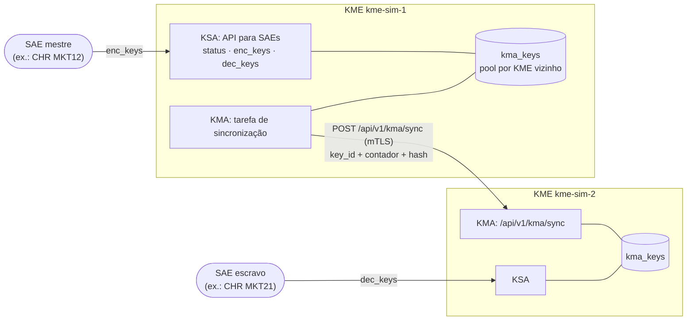
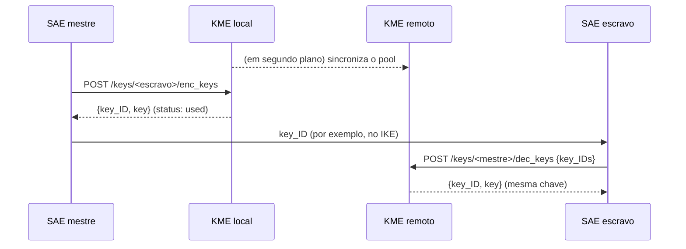

# KME — `main.py` (KMS-sim)

Servidor **KME** (*Key Management Entity*) usado pelos laboratórios QNetLab. É o `main.py` do projeto KMS-sim,
**vendorizado sem alterações** (origem e SHA-256 em [`UPSTREAM.md`](UPSTREAM.md); o arquivo é somente leitura).
Esta página documenta o que o código faz; o QNetLab só **gera a configuração** (`kme_config.yaml`) e empacota o programa na imagem.

| | |
|---|---|
| Linguagem / dependências | Python 3, Flask ≥ 3, PyYAML (`docker/node/requirements.txt`) |
| Padrões implementados | ETSI GS QKD 014 V1.1.1 (API REST do KME) + sub-camadas **KMA/KSA** (ITU-T Y.3803) |
| Transporte | HTTPS com **mTLS** (TLS ≥ 1.2); servidor `werkzeug.serving.run_simple` |
| Armazenamento | SQLite (um arquivo por KME) |
| Execução | `python3 main.py --config kme_config.yaml` (ou `KME_CONFIG`) |
| Porta | a de `listen` (QNetLab: `0.0.0.0:8443`) |

> É um **simulador**: as chaves não vêm de hardware quântico. Dois KMEs vizinhos derivam as **mesmas** chaves a partir de uma
> *seed* compartilhada e de um contador. Não use em produção.

## 1. Modelo de funcionamento



- **Camada KMA** (entre KMEs): mantém, para cada KME vizinho, um *pool* de chaves idênticas nas duas pontas.
- **Camada KSA** (para SAEs): entrega chaves desse *pool* ao SAE **mestre** (`enc_keys`) e depois ao **escravo**, pelo `key_ID` (`dec_keys`).
- A **identidade do SAE** é o *Common Name* (CN) do certificado cliente TLS (`SSL_CLIENT_CN`).

### Geração e sincronização de chaves (KMA)

Para cada par de KMEs vizinhos existe uma `seed` (a mesma nos dois lados) e um contador. Uma chave é:

```text
key_data = base64( SHA-256( "<seed>:<contador>" ) )        # 32 bytes = 256 bits
hash     = SHA-256( key_data ) em hexadecimal
```

1. **Quem inicia:** só o KME de **menor `local_kme_id`** (comparação de *strings*) inicia a sincronização com o vizinho
   (`if KME_ID >= peer_id: continue`). No anel de 4 sites: `kme-sim-1` inicia para 2 e 4; `kme-sim-2` para 3; `kme-sim-3` para 4.
2. **Varredura** a cada `sync_interval_s`: se o *pool* sincronizado com o vizinho tem menos que `sync_threshold` chaves,
   gera `min(10, sync_threshold − atual)` chaves.
3. Para cada chave: incrementa o contador local, calcula `key_data`/`hash`, cria um `key_ID` (UUID v4) e envia
   `POST {base_url}/api/v1/kma/sync` com `{qkd_key_id, peer_kme_id, counter, hash_value, key_size_bits}`.
4. **Receptor:** localiza o *link* pelo `peer_kme_id`, recalcula a chave com a **sua** cópia da seed e do contador recebido,
   confere o hash (`400 Hash mismatch` se divergir), grava a chave como `synchronized` e avança o contador local se o recebido for maior.
5. Se o vizinho responde `200`, o iniciador grava a mesma chave como `synchronized` no seu *pool*.
6. **Falhas:** até `max_retries` tentativas por chave, com espera de `2^n` s entre elas; pausa de `generation_delay_s` entre chaves
   (controla a taxa de geração simulada). O hash garante que, quando ambos gravam uma chave, o material é idêntico (se a resposta `200` se perder, só o receptor fica com a chave a mais).

> O contador é incrementado **antes** do envio; uma tentativa que falha deixa um "buraco" na contagem (inofensivo, pois o receptor
> usa o contador recebido).

## 2. Configuração (`kme_config.yaml`)

O QNetLab gera este arquivo (`templates/docker/kme_config.yaml.j2`). Chaves **obrigatórias**: `listen`, `local_kme_id`, `tls`,
`storage`, `peer_sync`, `kme_topology`; ausência ⇒ `SystemExit("Config error: …")`.

| Chave | Obrigatória | Padrão | Descrição |
|---|---|---|---|
| `listen` | sim | — | `host:porta` (ou só a porta ⇒ `0.0.0.0`). |
| `local_kme_id` | sim | — | ID deste KME; precisa existir em `kme_topology`. |
| `use_mTLS` | não | `true` | `true` ⇒ `CERT_REQUIRED` (cliente sem certificado é recusado); `false` ⇒ `CERT_OPTIONAL` (CN = `unknown`). |
| `tls.server_cert_path` / `server_key_path` | sim | — | Certificado e chave do servidor. |
| `tls.client_ca_cert_path` | sim | — | CA que assina os certificados dos clientes (SAEs e KMEs vizinhos). |
| `storage.type` | sim | — | Somente `sqlite`. |
| `storage.params.path` | sim | — | Arquivo SQLite (diretório criado se necessário). |
| `peer_sync.type` | sim | — | Somente `http_mtls`. |
| `peer_sync.sync_interval_s` | não | `5` | Intervalo entre varreduras. |
| `peer_sync.sync_threshold` | não | `100` | Chaves sincronizadas mantidas por vizinho. |
| `peer_sync.request_timeout_ms` | não | `5000` | Timeout de cada requisição de sync. |
| `peer_sync.max_retries` | não | `3` | Tentativas por chave. |
| `peer_sync.generation_delay_s` | não | `0.5` | Pausa entre chaves de uma varredura. |
| `peer_sync.peers.<id>.base_url` | sim | — | URL HTTPS do vizinho (ex.: `https://172.16.100.2:8443`). |
| `peer_sync.peers.<id>.seed` | sim | — | *Seed* **idêntica** nos dois KMEs do par. |
| `peer_sync.peers.<id>.client_cert_path` / `client_key_path` | sim | — | Credenciais usadas ao falar com o vizinho. |
| `peer_sync.peers.<id>.server_ca_cert_path` | sim | — | CA para validar o vizinho. |
| `kme_topology.<kme_id>.connected_saes` | sim | — | SAEs de cada KME. Os SAEs de KMEs **remotos** viram rotas de chave (§3). |
| `logging.level` | não | `INFO` | Nível de log. |
| `logging.file_path` | não | `/var/log/kme.log` | Arquivo de log (também vai ao `stderr`). |

Variável de ambiente: `KME_CONFIG` (caminho do YAML se `--config` não for dado). Os parâmetros de `peer_sync` no QNetLab vêm da seção
`kme:` da topologia ([referência](../../../docs/05-configuration-reference.md)).

## 3. API REST

Base: `https://<kme>:<porta>/api/v1`. Todas as chamadas exigem certificado cliente (com `use_mTLS: true`).

### KSA — para SAEs

| Método e caminho | Papel | Descrição |
|---|---|---|
| `GET /keys/<slave_SAE_ID>/status` | mestre | Estado do *pool* para o SAE escravo informado. |
| `GET\|POST /keys/<slave_SAE_ID>/enc_keys` | mestre | Entrega chaves novas (`number`, `size`). |
| `GET\|POST /keys/<master_SAE_ID>/dec_keys` | escravo | Entrega as chaves pelos `key_ID`. |

**Roteamento.** O `<slave_SAE_ID>` precisa estar em `kme_topology` de um **KME remoto**: a rota `SAE → KME vizinho` escolhe o
*pool*. Se o escravo é um SAE **local**, `enc_keys` responde `400 "No KMA route found for slave SAE"`.

**`status`** responde `source_KME_ID`, `target_KME_ID`, `master_SAE_ID` (= CN do cliente), `slave_SAE_ID`, `key_size` (256),
`stored_key_count` (chaves `synchronized` do *pool*), `max_key_count` (100000), `max_key_per_request` (128),
`max_key_size` (1024), `min_key_size` (64), `max_SAE_ID_count` (0: sem *multicast*).

**`enc_keys`** — parâmetros em *query string* ou JSON (`{"number": 1, "size": 256}`); padrão `number=1`, `size=256`.

| Regra | Resposta |
|---|---|
| `extension_mandatory` não vazio | `400` (nenhuma extensão é suportada) |
| `size` não múltiplo de 8 | `400 size shall be a multiple of 8` |
| `size ≤ 128` | **interpretado como bytes** e convertido para bits (`32` ⇒ 256; gera *warning*) |
| `number` fora de 1–128 | `400` |
| `size` (em bits) ≠ 256 | `400` — o KME só entrega chaves de 256 bits |
| *pool* sem chaves suficientes | `503 Not enough synchronized KMA-keys available` (nada é consumido) |
| sucesso | `200 {"keys":[{"key_ID": "<uuid>", "key": "<base64>"}, …]}`; as chaves passam a `used` |

**`dec_keys`** — corpo `{"key_IDs":[{"key_ID":"…"}]}` (POST) ou `?key_ID=…` (GET). Chave inexistente ou fora de
`synchronized`/`used` ⇒ `400` (tudo-ou-nada, sem consumo parcial); sucesso ⇒ `200 {"keys":[…]}`.

### KMA — entre KMEs (interno)

`POST /kma/sync` — usado pelo iniciador da sincronização (§1). Respostas: `200 Synchronized`, `400` (JSON inválido, campos
ausentes ou hash divergente), `404 Unknown KMA link`, `500`.

### Fluxo típico de um par de SAEs



## 4. Banco de dados (SQLite)

| Tabela | Conteúdo |
|---|---|
| `kma_links` | `peer_kme_id` (PK), `seed`, `peer_url`, `counter` — um registro por KME vizinho (recarregado do YAML a cada início; o contador é preservado). |
| `sae_routes` | `sae_id` → `peer_kme_id` — SAEs de KMEs remotos. |
| `kma_keys` | `key_id` (PK), `peer_kme_id`, `key_data` (base64), `key_size_bits`, `status` (`synchronized` \| `used`). |
| `keys` | tabela legada, não usada. |

Consulta útil do nível dos *pools* (o coletor do QNetLab usa a mesma):

```console
$ docker exec GNS3.KME1.<project_id> python3 -c "import sqlite3;c=sqlite3.connect('/opt/kme/data/kme-sim-1.db');print(list(c.execute('SELECT peer_kme_id,status,COUNT(*) FROM kma_keys GROUP BY 1,2')))"
```

## 5. TLS e identidade

- **Servidor:** `ssl.create_default_context(CLIENT_AUTH)`, TLS ≥ 1.2, exige certificado de cliente assinado pela `client_ca_cert_path`.
- **CN do cliente → SAE:** um *handler* customizado (`MtlsRequestHandler`) copia o CN do certificado do cliente para
  `environ["SSL_CLIENT_CN"]`; esse é o `master_SAE_ID`/`slave_SAE_ID` nos logs e nas respostas.
- **Cliente (sync):** contexto TLS novo a cada requisição, `check_hostname = False` (conexão por IP), cifras
  `DEFAULT@SECLEVEL=1`; a cadeia é validada contra `server_ca_cert_path`.
- No QNetLab, o certificado do KME tem CN `kme-sim-i` e SAN com todos os seus IPs; o dos CHRs tem CN `sae-chrXY`.

## 6. Logs

Formato `data nível [thread] mensagem`, em `logging.file_path` e no `stderr` (`docker logs`). Eventos úteis:
`Generating N keys for peer …`, `Successfully synced X/N keys …`, `enc_keys: master=… slave=… peer_kme=… count=…`,
`dec_keys: slave=… master=…`, `KMA sync hash mismatch …`. O QNetLab coleta o arquivo em `logs/KME<i>.log`.

## 7. Como o QNetLab usa este programa

| Item | Valor |
|---|---|
| Imagem | `/opt/qnetlab/kme/main.py` (copiado de `docker/node/kme/`) |
| Entrypoint | `ROLE=kme` ⇒ `cd /opt/qnetlab/kme && exec python3 main.py --config /etc/qnetlab/kme_config.yaml` |
| Configuração | gerada por KME; `seed` por par em `build/<lab>/state.json` |
| Certificados | `/certs` (CA + certificado e chave do KME), embutidos na imagem |
| Banco / log | `/opt/kme/data/<kme-id>.db` · `/var/log/kme.log` |
| Clientes | os CHRs (`/ip ipsec key qkd`, `peer-sae-id` = CHR do outro lado) e os KMEs vizinhos |
| Substituir | `containers.kme_source_dir: <pasta com main.py>` |

### Testando à mão (dentro do contêiner do KME)

Use o certificado do próprio KME como cliente (o SAN inclui `127.0.0.1`). O CN será `kme-sim-1`.

```console
$ docker exec -it GNS3.KME1.<project_id> sh
# curl -s --cacert /certs/ca.crt.pem --cert /certs/kme-sim-1.crt.pem --key /certs/kme-sim-1.key.pem \
    https://127.0.0.1:8443/api/v1/keys/sae-chr21/status
```

> **Atenção:** `enc_keys` **consome** chaves do *pool* (marca como `used`). Evite chamá-lo durante um experimento com IPsec/QKD.

## 8. Limitações e pontos de atenção (comportamento do código)

- **Sem autorização por SAE:** qualquer cliente com certificado assinado pela CA é aceito; o KME **não** confere se o CN está em
  `connected_saes` nem se o CN do chamador de `/kma/sync` coincide com o `peer_kme_id`.
- **Segredo de laboratório:** a chave é função determinística da `seed` e do contador; quem conhece a seed reproduz as chaves.
- **Chaves de 256 bits apenas** (`DEFAULT_KEY_SIZE_BITS`); `size ≤ 128` é lido como bytes.
- **Sem expiração/limpeza:** chaves `used` permanecem no banco; `dec_keys` pode ser repetido para o mesmo `key_ID`.
- **Servidor de desenvolvimento** (`werkzeug.run_simple`, sem `threaded=True` explícito): adequado ao laboratório, não à produção.
- **Iniciador por ordem lexicográfica:** `"kme-sim-10" < "kme-sim-2"`; em anéis com ≥ 10 sites o iniciador de alguns pares muda,
  mas continua único por par (os dois lados aplicam a mesma regra).
- **Multicast** não suportado (`max_SAE_ID_count: 0`).
- Importado como módulo (`import main`), apenas cria o *logger*: a configuração só é carregada no modo `__main__`.
