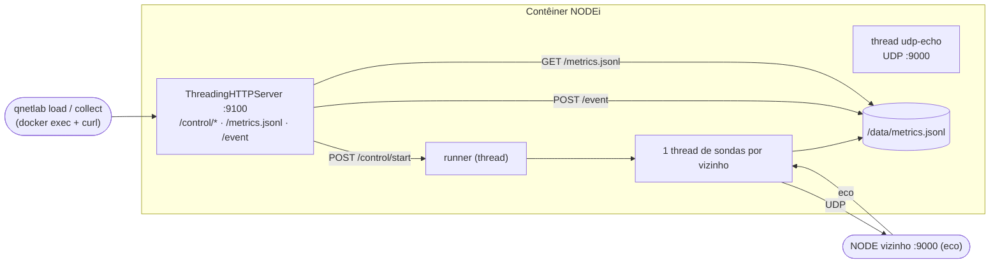

# Agente do NODE — `src/main.py`

Agente embutido nos contêineres **NODE** dos laboratórios QNetLab (`ROLE=app`). Programa único, só **biblioteca padrão** do
Python (sem dependências), que:

1. responde a sondas UDP (**eco**), para que os NODEs vizinhos meçam latência;
2. quando comandado, envia **sondas UDP** aos NODEs vizinhos e mede **RTT e perda** através dos túneis IPsec/QKD;
3. expõe uma **API HTTP de controle** e as métricas;
4. grava tudo em um log de eventos **JSON-lines**.

É o componente que o `qnetlab load` e o `qnetlab collect` comandam (via `docker exec`). Para colocar a **sua aplicação** no lugar dele,
veja §7.

| | |
|---|---|
| Arquivo | `docker/node/sae/src/main.py` (≈ 220 linhas) |
| Dependências | nenhuma (Python 3.12 da imagem-base) |
| Execução | `python /opt/qnetlab/sae/src/main.py` (pelo `entrypoint.sh`, `ROLE=app`) |
| Portas | UDP `PROBE_PORT` (9000) · TCP/HTTP `METRICS_PORT` (9100), ambas em `0.0.0.0` |
| Saída | `/data/metrics.jsonl` (acumulativo) |

## 1. Arquitetura



Na inicialização o agente: inicia a *thread* de eco UDP, cria o servidor HTTP, registra o evento `boot` e imprime
`[sae] <SAE_ID> pronto: eco UDP :<porta>, controle HTTP :<porta>`.

## 2. Configuração (variáveis de ambiente)

Definidas pelo QNetLab (`containers/env.py`) e lidas na carga do módulo.

| Variável | Padrão | Descrição |
|---|---|---|
| `SAE_ID` | `SAE_APP` | Identificador do agente (QNetLab: o nome do nó, ex.: `NODE1`). |
| `NODE_NAME` | `SAE_ID` | Valor do campo `node` nos eventos. |
| `PEERS` | vazio | Vizinhos a sondar: `nome=ip=protegido=sae,…` (ex.: `NODE4=10.0.3.30=1=,NODE2=10.0.3.10=1=`). Itens com ≠ 4 campos são ignorados. `protegido` = `1` marca a sonda como `protected: true`. |
| `PROBE_PORT` | `9000` | Porta UDP do eco **e** destino das sondas. |
| `METRICS_PORT` | `9100` | Porta do servidor HTTP. |
| `DATA_DIR` | `/data` | Diretório do `metrics.jsonl` (criado se não existir). |
| `KEY_SIZE_BITS` | `256` | Tamanho de chave do `key_loop` (inativo no QNetLab, §6). |
| `KME_URL` | vazio | URL do KME para o `key_loop`; **vazio ⇒ nenhum pedido de chave** (padrão no QNetLab). |
| `CERT_DIR` | `/certs` | Certificados do `key_loop` (`ca.crt.pem`, `<SAE_ID>.crt.pem`, `<SAE_ID>.key.pem`). |

## 3. Sondas UDP (RTT e perda)

Para cada vizinho de `PEERS`, uma *thread* repete até `duration` segundos:

1. monta o datagrama `struct.pack("!Id", seq, t0)` (4 bytes de sequência + 8 bytes de relógio monotônico, **12 bytes**)
   seguido de *padding* de zeros de `size − 16` bytes ⇒ **payload UDP de `size − 4` bytes** (60 bytes com o padrão `size=64`);
2. envia a `ip:PROBE_PORT` e aguarda até **1 s** a resposta com o mesmo `seq` (respostas atrasadas de sondas anteriores são descartadas);
3. `rtt_ms = (perf_counter() − t0) × 1000` — medido **localmente**, portanto não depende de sincronismo de relógio;
   sem resposta em 1 s ⇒ `rtt_ms = null` (**perda**);
4. grava o evento `probe` e dorme `interval − tempo_gasto` (se a sonda esperou 1 s, o ritmo efetivo cai).

Sentido das sondas: cada NODE sonda o NODE **anterior** (saindo por `eth0`, via `MKTi1`) e o **próximo** (por `eth1`, via `MKTi2`); a rota
estática do NODE e o OSPF levam o tráfego aos túneis do enlace `ether2`.

## 4. API HTTP de controle

Servidor `ThreadingHTTPServer` em `0.0.0.0:METRICS_PORT`. Respostas em JSON, exceto `/metrics.jsonl`; logs de acesso silenciados.

| Método e caminho | Corpo | Resposta |
|---|---|---|
| `GET /control/status` | — | `{"sae_id", "phase" ("idle"\|"running"), "started", "params", "running"}` |
| `POST /control/start` | `{"duration":60, "interval_ms":100, "size":64, "key_interval_s":5}` (todos opcionais) | `{"status":"started","peers":[nomes]}`; `{"status":"busy"}` se já houver carga |
| `POST /control/stop` | — | `{"status":"stopping"}` (as sondas terminam na próxima iteração) |
| `GET /metrics.jsonl` | — | conteúdo **inteiro** do log (`application/x-ndjson`; vazio se não existir) |
| `POST /event` | JSON livre | `{"status":"ok"}`; `type` padrão `"event"`; entra no log |
| qualquer outro | — | `404`; JSON inválido em `POST` ⇒ `400 {"error":"JSON inválido"}` |

Parâmetros de `/control/start`: `duration` (s, padrão 60), `interval_ms` (padrão 100), `size` (bytes, mínimo 16, padrão 64),
`key_interval_s` (padrão 5; o QNetLab envia o valor de `load.key_interval_s`, 0 por padrão).

Exemplos (dentro do contêiner, ou com `docker exec GNS3.NODE1.<project_id> …`):

```console
$ curl -s localhost:9100/control/status
$ curl -s -X POST localhost:9100/control/start -d '{"duration":30,"interval_ms":50,"size":128}'
$ curl -s -X POST localhost:9100/event -d '{"type":"accuracy","round":3,"value":0.91}'
$ curl -s localhost:9100/metrics.jsonl | tail -n 3
```

## 5. Formato do log (`metrics.jsonl`)

Uma linha JSON por evento, compacta; o agente acrescenta `t` (epoch, s) e `node` quando ausentes. Escrita serializada por *lock*,
em modo *append*.

| `type` | Campos | Quando |
|---|---|---|
| `boot` | `sae_id`, `peers` | início do agente |
| `phase` | `phase`: `start` (com `params`) \| `end` | início/fim de uma carga |
| `probe` | `peer`, `protected`, `seq`, `rtt_ms` (`null` = perdida), `size` | cada sonda |
| `key_request` | `peer`, `ok`, `error`, `latency_ms` | só se o `key_loop` rodar (§6) |
| *livre* | qualquer | `POST /event` |

```json
{"type":"probe","peer":"NODE2","protected":true,"seq":17,"rtt_ms":4.213,"size":64,"t":1731312000.5,"node":"NODE1"}
```

O arquivo **não é truncado nem rotacionado**: execuções repetidas se acumulam (use os eventos `phase` para separá-las).
Quem consome: `qnetlab collect` (copia para `build/<lab>/metrics/NODEi.jsonl`) e `telemetry/plot_metrics.py` (resumos e gráficos).
Esquema completo e interpretação: [`docs/10-operations-telemetry.md`](../../../docs/10-operations-telemetry.md).

## 6. Pedidos de chave ao KME (`key_loop`) — inativo neste laboratório

O código inclui um laço que, para o **primeiro** vizinho, faz `POST {KME_URL}/api/v1/keys/<sae>/enc_keys` por mTLS a cada
`key_interval_s` e registra `key_request` (sucesso se `200` com `keys`). Ele só roda se `KME_URL` estiver definido, e **o QNetLab não o define**:
nos laboratórios, os SAEs são os **CHRs** (que obtêm as chaves do KME pelo `/ip ipsec key qkd`), não os NODEs. Além disso:

- a imagem do NODE não traz `/certs`, e o campo `sae` de `PEERS` fica vazio, então a URL ficaria `…/keys//enc_keys`;
- com `key_interval_s = 0` o laço não dorme (`_stop.wait(0)`) e martelaria o KME — não o ative sem intervalo positivo.

## 7. Substituindo ou estendendo o agente

- **Estender:** edite `docker/node/sae/src/main.py` e rode `qnetlab images` + `qnetlab deploy` (a imagem-base é reconstruída).
- **Trocar pela sua aplicação** (ex.: cliente DFL): `containers.app_source_dir: <pasta>` com `src/main.py`; o conteúdo é copiado para
  `/opt/qnetlab/sae/`. Receberá as mesmas variáveis de ambiente (§2). Para continuar usando `qnetlab load/collect`, implemente
  `GET /control/status`, `POST /control/start` e `GET /metrics.jsonl` com a semântica acima; do contrário gere os `*.jsonl` você mesmo e use
  `qnetlab collect --offline`.
- **Eventos da aplicação:** envie `POST /event` com `type` próprio; `accuracy` (`round`, `value`) já tem gráfico (`accuracy.png`).

## 8. Limitações e pontos de atenção

- **API sem autenticação**, em `0.0.0.0`: qualquer host que alcance o NODE (CHRs, outros NODEs pelos túneis) pode iniciar/parar a carga ou injetar eventos.
  Aceitável no laboratório isolado.
- **Tamanho da sonda:** o payload real é `size − 4` bytes (cabeçalho de 12 bytes contra *padding* calculado com 16); o mínimo de `size` é 16.
- **Só UDP:** não mede vazão nem conexões TCP; para vazão use `iperf3` (instalado na imagem).
- **Perda** = ausência de resposta em 1 s; respostas fora de ordem ou duplicadas não são contabilizadas.
- **Uma carga por vez** (`busy`); `/control/stop` só sinaliza a parada (o sinal permanece ativo até o próximo `start`, que o limpa).
- O log cresce sem limite e `/metrics.jsonl` o lê por inteiro a cada requisição.
- Sem tratamento de sinais/encerramento ordenado: o contêiner é parado pelo GNS3.
