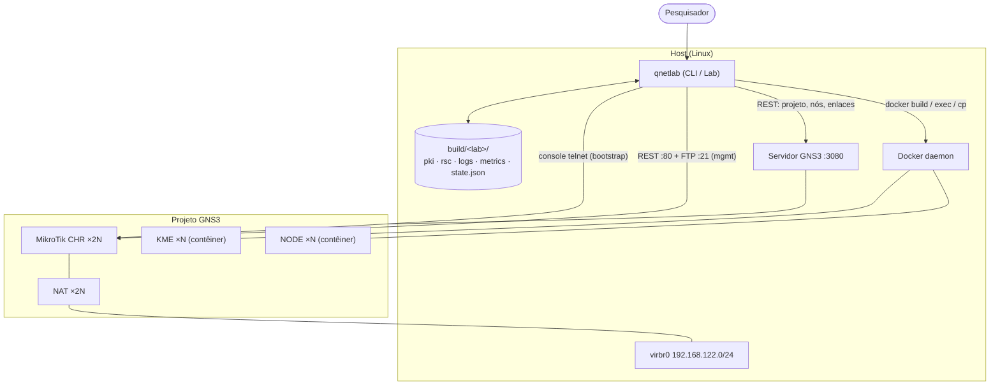
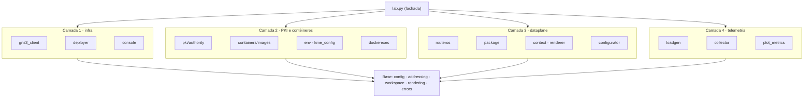
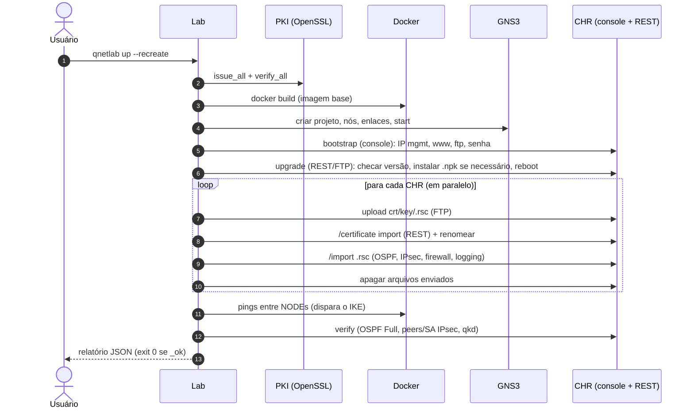
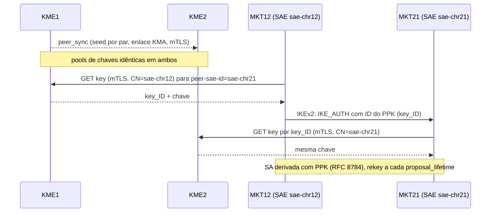

# 02 — Arquitetura

## 1. Visão de contexto

Quatro canais de controle, cada um com um propósito:

| Canal | Alvo | Uso | Camada |
|---|---|---|---|
| HTTP REST (3080) | GNS3 | criar projeto/nós/enlaces, iniciar/parar | 1 |
| Console telnet serial | CHR | *bootstrap*: IP de mgmt, `www`, `ftp`, senha | 3 |
| REST `/rest` + FTP | CHR (via NAT/mgmt) | comandos, importar certificados e `.rsc`, atualizar RouterOS, coletar logs | 3, 4 |
| `docker exec` / `docker cp` | KME, NODE | ler métricas, logs, pools de chaves; disparar tráfego | 3, 4 |

KMEs e NODEs **não têm rede de gerenciamento**: toda interação passa por `docker exec` no contêiner
`GNS3.<nó>.<id-do-projeto>` (o ID está em `state.json`).

## 2. As quatro camadas

### Camada base

| Módulo | Responsabilidade |
|---|---|
| `config.loader` | Lê YAML/JSON, interpola `${VAR}`, rejeita chaves desconhecidas, constrói `Topology`. |
| `config.models` | Dataclasses **imutáveis** (`frozen=True`) e `Topology.validate()`. Única fonte de tipos e padrões. |
| `addressing` | Função pura `build_plan(topology) → AddressPlan` (sem E/S): IPs, enlaces, túneis, rotas dos NODEs. |
| `workspace` | Diretórios de saída e `state.json` (IDs do GNS3 e segredos, modo `0600`, escrita atômica). |
| `rendering` | Ambiente Jinja2 com `StrictUndefined`: variável ausente = erro, nunca texto vazio. |
| `errors` | Hierarquia `QNetLabError` (`ConfigError`, `AddressingError`, `Gns3Error`, `ConsoleError`, `PkiError`, `ImageBuildError`, `RouterOsError`, `TelemetryError`). |

### Camada 1 — infra (`qnetlab.infra`)

- `Gns3Client`: sessão `requests` com *retry* em GET/PUT/DELETE (502/503/504), mensagens de erro com status e corpo.
  Localiza templates (`MikroTik CHR` e o template nativo `NAT`).
- `TopologyDeployer`: cria o projeto, os nós (CHR por template, KME/NODE como `docker`, NAT pelo template nativo, renomeado
  `NAT1..NAT2N`), liga os enlaces por `adapter_number`/`port_number`, inicia tudo e grava `project_id`/`nodes` em
  `state.json`. `--recreate` apaga um projeto de mesmo nome antes.
- `TelnetConsole` / `RouterOsConsole`: login serial/telnet para o *bootstrap*, tolerante a prompts repetidos.

Mapeamento de interfaces → portas do GNS3:

| Nó | Nome da interface | `adapter_number` | `port_number` |
|---|---|---|---|
| CHR | `etherK` | K − 1 | 0 |
| Docker (KME/NODE) | `ethK` | K | 0 |
| NAT | `nat0` | 0 | 0 |

### Camada 2 — PKI e contêineres

- `CertificateAuthority` (OpenSSL via `subprocess`): Root CA, certificados por entidade, idempotente por *fingerprint*
  de (CN, SANs, tipo de chave). Detalhes em [07](07-security.md).
- `ImageBuilder`: monta o contexto Docker, `docker build` da imagem-base, gera `docker-compose.yml` para testes sem GNS3.
- `kme_config`: gera o `kme_config.yaml` de cada KME (vizinhos, *seeds* por par, SAEs conectados).
- `DockerExec`: `exec`, `http`/`http_json` (via `curl` dentro do contêiner) e `cp_from`.

### Camada 3 — dataplane (`qnetlab.dataplane`)

- `AddressPlan → context.py → RouterConfigRenderer`: o contexto Jinja de cada CHR é montado a partir do plano; os templates
  `templates/mikrotik/*.rsc.j2` produzem `build/<lab>/rsc/<CHR>.rsc` (e `.bootstrap.rsc`).
- `RouterOsClient`: cliente REST/FTP do RouterOS 7 (comandos, importação, versão, atualização, consultas de estado).
- `package.py`: descobre a versão mais recente do canal e baixa/cacheia o `.npk` para a atualização *host-side*.
- `DataPlaneConfigurator`: orquestra `bootstrap`, `upgrade`, `configure`, `verify` (CHRs em paralelo, até 8 por vez).

### Camada 4 — telemetria (`qnetlab.telemetry`)

- `LoadRunner`: comanda os agentes dos NODEs (aquecimento, início, espera, parada).
- `TelemetryCollector`: reúne métricas dos NODEs, logs/estado dos CHRs e KMEs, consolida (`plot_metrics`) e empacota
  `output.tar.gz` com manifesto SHA-256 e segredos mascarados.

## 3. Fluxo do pipeline `up`

Cada etapa é também um subcomando independente ([06](06-cli-reference.md)); `up` apenas as encadeia.

## 4. Fluxo de chaves (como o QKD chega ao IPsec)

O ponto central é o **objeto único `/ip ipsec key qkd`** de cada CHR (um `peer-sae-id`). Como cada CHR tem exatamente um
enlace `ether2`, há exatamente um túnel por CHR e não há ambiguidade.

## 5. Princípios de projeto

1. **Declarativo e determinístico.** Topologia → plano é função pura; mesmos insumos, mesmos IPs.
2. **Idempotente.** Cada `.rsc` remove o que criou antes; PKI só reemite o que mudou; `deploy --recreate` recria.
3. **Uma fonte de verdade.** Tipos/padrões nos dataclasses; schema e referência derivam deles/validados por teste.
4. **Falhar cedo, com mensagem objetiva.** Exceções tipadas; a CLI converte em mensagem + código de saída.
5. **Segredos fora do código e dos pacotes.** `state.json` 0600; `.rsc` mascarados no `output.tar.gz`; chaves privadas nunca
   deixam `build/<lab>/pki`.
6. **Testável sem infraestrutura.** E/S (GNS3, REST, Docker, console) é injetável; os testes rodam offline.
7. **Somente MikroTik.** Sem Dynamips/Cisco, sem switches: a conectividade é ponto a ponto.

## 6. Decisões de projeto

As decisões e seus motivos estão em [decisions.md](decisions.md).
