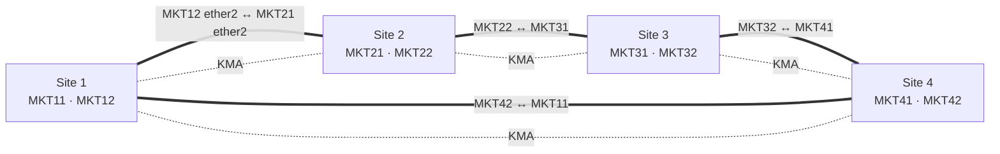

# 03 — Topologia e endereçamento

Tudo nesta página é **derivado** por `qnetlab.addressing.build_plan()` a partir de `ring.size` e dos pools; os exemplos
abaixo foram obtidos com `qnetlab plan -t topologies/ring4.yaml`. Para ver o plano de qualquer topologia:

```console
$ qnetlab plan -t topologies/ring4.yaml          # tabela legível
$ qnetlab plan -t topologies/ring4.yaml --json   # mesma informação, para scripts
```

## 1. Estrutura

Cada **site *i*** contém:

| Elemento | Nome | Observação |
|---|---|---|
| 2 roteadores | `MKTi1`, `MKTi2` | MikroTik CHR; SAEs `sae-chri1`, `sae-chri2` |
| 1 KME | `KMEi` | contêiner; `kme_id` = `kme-sim-i` |
| 1 NODE | `NODEi` | contêiner com **2 NICs** (`eth0`←MKTi1, `eth1`←MKTi2) |
| 2 NATs | `NAT{2(i-1)+1}`, `NAT{2(i-1)+2}` | um por CHR, em `ether8` |

Os sites formam um **anel**: o CHR `MKTi2` liga-se ao `MKT(i+1)1` (o último liga-se ao `MKT11`). Os KMEs formam um segundo
anel (enlaces KMA) em paralelo.

Um **site** (interfaces dos CHRs em `etherN`, dos contêineres em `ethN`):

```text
                    KMEi ── eth0 / eth1 (KMA) ── KMEs vizinhos
                  eth2 │       │ eth3
                ether1 │       │ ether1
 NATa ─ ether8 ─ MKTi1 ─ ether3 ══ ether3 ─ MKTi2 ─ ether8 ─ NATb
               ether7 │ ether2     ether2 │ ether7
                      │    └─ MKT(i−1)2    MKT(i+1)1 ─┘    │
                      └──── eth0   NODEi   eth1 ───────────┘
```

`ether2` de `MKTi1` liga ao `MKT(i−1)2`; `ether2` de `MKTi2` liga ao `MKT(i+1)1` (enlaces protegidos por IPsec/QKD).

O **anel** (exemplo com 4 sites; os enlaces `ether2` carregam os túneis IPsec/QKD e o anel de KMEs corre em paralelo):



Linhas grossas: enlaces `ether2` (um túnel IPsec/QKD cada). Linhas pontilhadas: enlaces KMA entre KMEs.

## 2. Papéis das interfaces

Os papéis vêm de `router.if_*` (padrão = laboratórios MITACS).

| Interface do CHR | Papel | Vizinho | Pool | Protegida por IPsec | OSPF |
|---|---|---|---|---|---|
| `ether1` | `kme` | KME do site | `kme_access_pool` | — | passiva |
| `ether2` | `ring` | CHR do site vizinho | `ring_pool` | **sim** (transporte do túnel) | ativa, `ptp` |
| `ether3` | `sibling` | outro CHR do site | `sibling_pool` | — | ativa, `ptp` |
| `ether7` | `node` | NODE do site | `node_pool` | tráfego entre NODEs é cifrado | passiva |
| `ether8` | `mgmt` | nó NAT do GNS3 | `mgmt_subnet` | — | fora |

| Interface do KME | Vizinho |
|---|---|
| `eth0` | próximo KME (KMEi+1), enlace KMA |
| `eth1` | KME anterior (KMEi−1), enlace KMA |
| `eth2` | CHR 1 do site (`ether1`) |
| `eth3` | CHR 2 do site (`ether1`) |

| Interface do NODE | Vizinho |
|---|---|
| `eth0` | CHR 1 do site (`ether7`) |
| `eth1` | CHR 2 do site (`ether7`) |

## 3. Regras de endereçamento

Todo enlace ponto a ponto é um `/30` com `.1` e `.2`. Com *i* = site, *j* ∈ {1,2}, *N* = `ring.size`, *r* = índice do enlace
entre sites (1..N):

| Enlace | Pool (padrão) | Bloco `/30` | `.1` | `.2` |
|---|---|---|---|---|
| KME ↔ CHR | `10.0.0.0/24` | `2(i−1)+(j−1)` | KME (`eth{1+j}`) | CHR (`ether1`) |
| CHR ↔ CHR entre sites | `10.0.1.0/24` | `r mod N` (enlace *r* = `MKTr2` ↔ `MKT(r+1)1`) | o de menor (site, *j*) | o outro |
| CHR ↔ CHR no site | `10.0.2.0/24` | `i−1` | `MKTi1` | `MKTi2` |
| CHR ↔ NODE | `10.0.3.0/24` | `2(i−1)+(j−1)` | CHR (`ether7`) | NODE (`eth{j−1}`) |
| KME ↔ KME (KMA) | `172.16.100.0/24` | `r−1` | KMEr (`eth0`) | KME(r+1) (`eth1`) |

Demais:

- **router-id OSPF** = `router_id_pool.base + 10·i + j` (ex.: MKT11 → `10.255.0.11`).
- **Gerenciamento:** o CHR *k* (0-based, na ordem MKT11, MKT12, MKT21, …) recebe
  `mgmt_subnet` `.{mgmt_start + k·mgmt_step}` em `ether8` (padrão: `.10`, `.20`, `.30`, …). O gateway é o host
  (`192.168.122.1`).
- **NODEs** têm rotas estáticas para os `/30` dos NODEs vizinhos, via o CHR correspondente.
- **Validações:** pools disjuntos; cada pool comporta o número de `/30` exigidos; `mgmt_subnet` é `/24`; IPs de
  gerenciamento ≤ `.254` (⇒ com `mgmt_step: 10`, anel de até 12 sites / 24 CHRs; com `mgmt_step: 5`, até 24 sites).

## 4. Exemplo: ring4 (`qnetlab plan`)

### Nós

| Nó | Gerenciamento | Interfaces |
|---|---|---|
| MKT11 | 192.168.122.10 | e1 10.0.0.2/30 · e2 10.0.1.1/30 · e3 10.0.2.1/30 · e7 10.0.3.1/30 |
| MKT12 | 192.168.122.20 | e1 10.0.0.6/30 · e2 10.0.1.5/30 · e3 10.0.2.2/30 · e7 10.0.3.5/30 |
| MKT21 | 192.168.122.30 | e1 10.0.0.10/30 · e2 10.0.1.6/30 · e3 10.0.2.5/30 · e7 10.0.3.9/30 |
| MKT22 | 192.168.122.40 | e1 10.0.0.14/30 · e2 10.0.1.9/30 · e3 10.0.2.6/30 · e7 10.0.3.13/30 |
| MKT31 | 192.168.122.50 | e1 10.0.0.18/30 · e2 10.0.1.10/30 · e3 10.0.2.9/30 · e7 10.0.3.17/30 |
| MKT32 | 192.168.122.60 | e1 10.0.0.22/30 · e2 10.0.1.13/30 · e3 10.0.2.10/30 · e7 10.0.3.21/30 |
| MKT41 | 192.168.122.70 | e1 10.0.0.26/30 · e2 10.0.1.14/30 · e3 10.0.2.13/30 · e7 10.0.3.25/30 |
| MKT42 | 192.168.122.80 | e1 10.0.0.30/30 · e2 10.0.1.2/30 · e3 10.0.2.14/30 · e7 10.0.3.29/30 |
| KME1 | — | eth0 172.16.100.1/30 · eth1 172.16.100.14/30 · eth2 10.0.0.1/30 · eth3 10.0.0.5/30 |
| KME2 | — | eth0 172.16.100.5/30 · eth1 172.16.100.2/30 · eth2 10.0.0.9/30 · eth3 10.0.0.13/30 |
| KME3 | — | eth0 172.16.100.9/30 · eth1 172.16.100.6/30 · eth2 10.0.0.17/30 · eth3 10.0.0.21/30 |
| KME4 | — | eth0 172.16.100.13/30 · eth1 172.16.100.10/30 · eth2 10.0.0.25/30 · eth3 10.0.0.29/30 |
| NODE1 | — | eth0 10.0.3.2/30 · eth1 10.0.3.6/30 |
| NODE2 | — | eth0 10.0.3.10/30 · eth1 10.0.3.14/30 |
| NODE3 | — | eth0 10.0.3.18/30 · eth1 10.0.3.22/30 |
| NODE4 | — | eth0 10.0.3.26/30 · eth1 10.0.3.30/30 |

Rotas estáticas do NODE1: `10.0.3.28/30 via 10.0.3.1 dev eth0` (NODE4, pelo MKT11) e `10.0.3.8/30 via 10.0.3.5 dev eth1`
(NODE2, pelo MKT12).

### Túneis IPsec/QKD (um por enlace `ether2`)

| Túnel | SA (IP de `ether2` ↔ IP de `ether2`) | Rede protegida (A ↔ B) | SAE peer |
|---|---|---|---|
| MKT12-MKT21 | 10.0.1.5 ↔ 10.0.1.6 | 10.0.3.4/30 ↔ 10.0.3.8/30 | sae-chr12 ↔ sae-chr21 |
| MKT22-MKT31 | 10.0.1.9 ↔ 10.0.1.10 | 10.0.3.12/30 ↔ 10.0.3.16/30 | sae-chr22 ↔ sae-chr31 |
| MKT32-MKT41 | 10.0.1.13 ↔ 10.0.1.14 | 10.0.3.20/30 ↔ 10.0.3.24/30 | sae-chr32 ↔ sae-chr41 |
| MKT42-MKT11 | 10.0.1.2 ↔ 10.0.1.1 | 10.0.3.28/30 ↔ 10.0.3.0/30 | sae-chr42 ↔ sae-chr11 |

Em cada túnel, a política protege o `/30` CHR↔NODE de uma ponta contra o da outra; a SA é estabelecida entre os IPs de
`ether2`.

### Enlaces (36 no ring4)

20 intra-site (por site: 2 `kme-access`, 2 `node`, 1 `sibling`) + 4 `ring` + 4 `kma` + 8 `nat`. A lista completa sai de
`qnetlab plan`.

## 5. Nós NAT e gerenciamento

Cada CHR tem um nó **NAT** próprio (template nativo `NAT` do GNS3, ícone de nuvem) ligado a `ether8`:

- nomes sequenciais na ordem dos CHRs: `NAT1`↔MKT11, `NAT2`↔MKT12, `NAT3`↔MKT21, …;
- fornece o caminho **host ↔ CHR** (REST/FTP em `192.168.122.0/24`) e **CHR → Internet** (necessário para o
  `update_method: device`);
- o IP de cada CHR é fixo (configurado no *bootstrap* por console), pois o NAT do GNS3 não é fonte confiável de DHCP;
- `www` e `ftp` do RouterOS ficam restritos à rede de gerenciamento (`/ip service set … address=<mgmt_net>`).

> **Atenção:** o **host** precisa alcançar `192.168.122.0/24` (normalmente a bridge `virbr0`). Se o NAT parar de responder
> ARP/ICMP, todas as chamadas REST falham com `No route to host` (veja [11](11-troubleshooting.md#no-route-to-host-nos-chrs)).

Com `addressing.mgmt_attach: none` os nós NAT não são criados; o framework só consegue configurar roteadores se houver
outro caminho de gerenciamento.

## 6. Como o tráfego flui

1. `NODEi` → CHR local (`ether7`) → rota OSPF até o CHR do site vizinho via `ether2` (protegido) ou `ether3` (interno).
2. Em `ether2`, a política IPsec cifra o tráfego `NODE↔NODE` entre os `/30` protegidos (ESP, IKEv2, PPK=QKD).
3. O firewall descarta tráfego NODE↔NODE que saia/entre por `ether2` **sem** política IPsec (`enforce_encryption`).
4. Tráfego do próprio roteador no pool dos NODEs usa *bypass* (`action=none`), antes da política de túnel.
5. Enlaces listados em `ipsec.unprotected_links` não recebem túnel nem as regras de firewall da seção 40 (grupo de controle); nesses enlaces o tráfego flui em claro.

## 7. Diferenças em relação aos PDFs

O gerador é regular; os PDFs de origem não são totalmente. Normalizações assumidas:

| Item | PDF | QNetLab |
|---|---|---|
| ring6 | endereçamento regular | idêntico (verificado: MKT11 e1 10.0.0.2, e2 10.0.1.1, e3 10.0.2.1, e7 10.0.3.1; NODE1: `10.0.3.44/30 via 10.0.3.1 eth0`, `10.0.3.8/30 via 10.0.3.5 eth1`) |
| ring4 | blocos `/30` irregulares em alguns pools | blocos sequenciais regulares pela fórmula acima |
| Switches / Cisco | não aparecem | não existem (somente MikroTik) |
| NATs | presentes no laboratório físico | um nó NAT do GNS3 por CHR (`NAT1..NAT2N`) |

Se precisar do mapeamento exato do ring4 original, ajuste os pools em `addressing` ou estenda `build_plan()`
([12](12-development.md#5-estendendo-o-framework)).
