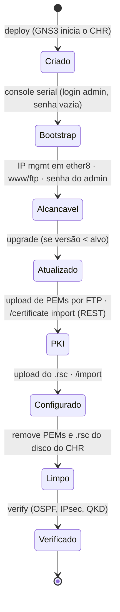

# 08 — Configuração dos roteadores (RouterOS)

Esta página explica **o que o QNetLab aplica em cada CHR**, em que ordem, e por quê. Os trechos foram gerados por
`qnetlab render -t topologies/ring4.yaml` (CHR `MKT11`, com segredos substituídos por `***`).

## 1. Ciclo de vida de um CHR



| Etapa | Canal | O que é feito |
|---|---|---|
| **bootstrap** | console telnet serial do GNS3 | `/ip dhcp-client remove [find]`; IP de gerenciamento em `ether8` (`comment=mgmt-bootstrap`); `/ip service set www,ftp disabled=no address=<mgmt_net>`; `/user set admin password=…`. Idempotente. Template: `bootstrap.rsc.j2`. |
| **upgrade** | REST + FTP | Lê versão/arquitetura; atualiza se `< alvo` (§2). |
| **PKI** | FTP + REST | Envia `ca.crt.pem`, `sae-chrXY.crt.pem`, `sae-chrXY.key.pem`; confere em `/file`; `/certificate import` (até 5 tentativas); renomeia para `qnetlab-ca` (`trusted=yes`) e `sae-chrXY`; apaga os PEMs. |
| **configure** | FTP + REST (`/import`) | Envia `qnetlab-<CHR>.rsc` e executa; sucesso = ausência de "Script Error" / "failure:"; apaga o `.rsc` do disco. |
| **verify** | REST | Vizinhos OSPF `Full`, `active-peers`, `installed-sa`, `key qkd`. |

## 2. Versão do RouterOS

`/ip ipsec key qkd` e `ppk=qkd` exigem **RouterOS ≥ 7.22**.

| Parâmetro | Efeito |
|---|---|
| `router.min_version` | Piso (padrão `7.22`). Vazio desliga a checagem. |
| `router.update_version` | Alvo **exato** (ex.: `7.22.1`). Vazio = usar `min_version` como alvo. |
| `router.auto_update` | `false` ⇒ só aborta com mensagem clara se estiver abaixo do alvo. |
| `router.update_method` | `host` (padrão) ou `device`. |
| `router.update_channel` | Canal usado para descobrir a versão mais nova quando `update_version` é vazio e o método é `host`. |

**Regra:** o alvo é `update_version` se definido, senão `min_version`. CHRs **abaixo** do alvo são atualizados; CHRs **iguais ou
mais novos** não são tocados (não há *downgrade*). Com `update_version` definido, o resultado final é verificado e qualquer
CHR diferente do alvo causa erro.

### Método `host` (padrão)

1. O host consulta `https://upgrade.mikrotik.com/routeros/NEWESTa7.<canal>` (só se `update_version` for vazio).
2. Baixa `https://download.mikrotik.com/routeros/<v>/routeros-<v>.npk` (x86; outras arquiteturas levam sufixo `-<arch>`)
   **uma vez** para `build/<lab>/cache/` e valida o tamanho (≥ 5 MB).
3. Envia o `.npk` por FTP a cada CHR (até 8 em paralelo) e executa `/system reboot`.
4. O RouterOS instala o pacote no boot; o framework espera a REST voltar e confere a versão.

Vantagem: não depende de DNS nem de Internet **dentro** do CHR (causa da falha original, ver
[11](11-troubleshooting.md#could-not-resolve-dns-name-timeout-na-atualização)).

### Método `device`

Cada CHR roda `/system package update` (rota/DNS temporários via NAT; `update_dns`, `update_timeout`). Falha rápido em estado
`ERROR` e executa um diagnóstico de conectividade (ping, DNS). Use só se o CHR tem Internet e DNS funcionais.

> **Atenção:** cada `make up --recreate` recria os CHRs a partir da imagem do template; se ela estiver em 7.16, a atualização
> se repete (~minutos por roteador). Atualize a imagem do template uma vez para evitar isso.
> Um CHR sem licença (trial) pode ter restrições de atualização.

## 3. Estrutura do `.rsc` gerado

Um arquivo por CHR, composto por seções (templates em `templates/mikrotik/`):

| Arquivo template | Seção | Conteúdo |
|---|---|---|
| `00_base.rsc.j2` | 00 base | identidade, IPs das interfaces, rotas estáticas |
| `10_ospf.rsc.j2` | 10 OSPFv2 | instância, área, *interface templates* |
| `20_pki.rsc.j2` | 20 PKI | só comentários (a PKI é feita por REST) |
| `30_ipsec.rsc.j2` | 30 IPsec | `key qkd`, profile, proposal, bypass, peer, identity, policy |
| `40_firewall.rsc.j2` | 40 firewall/NAT | IKE/ESP, descarte de claro, isenção de NAT |
| `50_logging.rsc.j2` | 50 logging | depuração IPsec em memória |
| `router.rsc.j2` | — | monta as seções na ordem acima |
| `bootstrap.rsc.j2` | — | usado só no console |

O cabeçalho de cada arquivo diz: *GERADO: não edite à mão; altere a topologia e rode `qnetlab configure`.*

### Idempotência

Cada seção **remove antes** o que ela cria:

| Objeto | Como é limpo | Observação |
|---|---|---|
| `/ip address`, `/ip route`, `/routing ospf interface-template`, `/ip firewall filter\|nat`, `/system logging` | `find where comment~"^qnetlab-"` | |
| `/ip ipsec policy` | `comment~"^qnetlab-"` | |
| `/ip ipsec profile` | `name="qkd-prof"` | RouterOS 7.22 **não aceita** `comment=` aqui |
| `/ip ipsec proposal` | `name="qkd-prop"` | idem |
| `/ip ipsec peer` | `name~"^to-"` | idem |
| `/ip ipsec identity` | `peer~"^to-"` | idem |
| `/routing ospf instance` / `area` | `name=ospf-v2` / `name=backbone` | nomes de `ospf.instance` / `ospf.area` |

> **Atenção:** `qkd-prof`, `qkd-prop` e peers `to-*` são nomes **reservados**. Objetos seus com esses nomes serão removidos.
> O IP de gerenciamento (`comment=mgmt-bootstrap`) não é tocado pelo `.rsc`.

## 4. Seção 00 — base

```routeros
/system identity set name=MKT11
/ip address remove [find where comment~"^qnetlab-"]
/ip address add address=10.0.0.2/30 interface=ether1 comment="qnetlab-kme KME1"
/ip address add address=10.0.1.1/30 interface=ether2 comment="qnetlab-ring MKT42"
/ip address add address=10.0.2.1/30 interface=ether3 comment="qnetlab-sibling MKT12"
/ip address add address=10.0.3.1/30 interface=ether7 comment="qnetlab-node NODE1"
/ip route add dst-address=10.0.3.28/30 gateway=10.0.1.2 comment="qnetlab-static route mkt42"
```

A rota estática leva o `/30` do NODE do site vizinho pelo `ether2`, garantindo que o tráfego case com a política IPsec
independentemente de convergência OSPF.

## 5. Seção 10 — OSPFv2

```routeros
/routing ospf instance add name=ospf-v2 version=2 router-id=10.255.0.11 comment=qnetlab-ospf
/routing ospf area add name=backbone area-id=0.0.0.0 instance=ospf-v2 comment=qnetlab-ospf
/routing ospf interface-template add area=backbone interfaces=ether1 passive comment="qnetlab-ospf kme"
/routing ospf interface-template add area=backbone interfaces=ether2 type=ptp cost=10 comment="qnetlab-ospf ring MKT42"
/routing ospf interface-template add area=backbone interfaces=ether3 type=ptp cost=10 comment="qnetlab-ospf sibling MKT12"
/routing ospf interface-template add area=backbone interfaces=ether7 passive comment="qnetlab-ospf node"
```

- `ether1` (KME) e `ether7` (NODE) são **passivas**: anunciam as redes sem formar adjacências.
- `ether2`/`ether3` são `ptp` (sem eleição de DR). Cada CHR deve ter **2 vizinhos `Full`** (um por `ether2`, um por `ether3`):
  é o critério do `verify`.

## 6. Seção 30 — IPsec IKEv2 + PPK (QKD)

```routeros
/ip ipsec key qkd set enabled=yes address=10.0.0.1:8443 certificate=sae-chr11 kme-id=kme-sim-1 peer-sae-id=sae-chr42 key-size=256 cache-size=10
/ip ipsec profile add name=qkd-prof dh-group=ecp384 enc-algorithm=aes-256 hash-algorithm=sha256 lifetime=1h ppk=qkd
/ip ipsec proposal add name=qkd-prop auth-algorithms=sha256 enc-algorithms=aes-256-cbc pfs-group=modp2048 lifetime=1m

/ip ipsec policy add src-address=10.0.3.1/32 dst-address=10.0.3.0/24 action=none comment="qnetlab-bypass router-originated"
/ip ipsec policy add src-address=10.0.3.0/24 dst-address=10.0.3.1/32 action=none comment="qnetlab-bypass router-destined"

/ip ipsec peer add name=to-MKT42 address=10.0.1.2/32 local-address=10.0.1.1 exchange-mode=ike2 profile=qkd-prof
/ip ipsec identity add peer=to-MKT42 auth-method=pre-shared-key secret="***"
/ip ipsec policy add peer=to-MKT42 tunnel=yes src-address=10.0.3.0/30 dst-address=10.0.3.28/30 proposal=qkd-prop action=encrypt level=require comment="qnetlab-policy"
```

| Elemento | Significado |
|---|---|
| `key qkd` | Cliente ETSI QKD 014 do RouterOS. `address` = IP do KME no `/30` de `ether1`; `certificate` = certificado SAE do CHR (seu **CN** é o `sae-id`); `kme-id` é validado contra o CN do KME; `peer-sae-id` = CHR do outro lado do túnel. Objeto **único** por roteador. |
| `key-size=256` | Valor de `ipsec.qkd_key_size`. A referência CLI do RouterOS fala em **bits** e a página de manual em bytes; o KMS-sim trata pedidos ≤ 128 como **bytes** (32 ⇒ 256 bits). Confirme no seu RouterOS. |
| `profile` | IKE: ECP-384 (DH), AES-256, SHA-256, SA de 1 h, **`ppk=qkd`** (PPK de origem QKD, RFC 8784). |
| `proposal` | ESP: AES-256-CBC + SHA-256, PFS `modp2048`, **`lifetime=1m`** (rekey por minuto = uma chave QKD por rekey). |
| bypass (`action=none`) | **Antes** da política de túnel; mantém fora do túnel o tráfego originado/destinado ao próprio roteador no pool dos NODEs (ex.: *ping* do roteador). |
| `peer`/`identity` | IKEv2 para o IP de `ether2` do vizinho; PSK **por túnel** (gerado e guardado em `state.json`). |
| `policy` | Cifra `NODE-local/30 ↔ NODE-remoto/30`, `action=encrypt level=require`. Sem `sa-src-address`/`sa-dst-address` (espelha os PDFs). |

Variações do `profile`/`identity` conforme a configuração:

| Configuração | `profile` | `identity` |
|---|---|---|
| `ppk_mode: qkd` (padrão) | `ppk=qkd` | `auth-method=pre-shared-key secret=…` |
| `ppk_mode: static` | `ppk=required` | `pre-shared-key` + `ppk=required ppk-id=… ppk-secret=…` (sintaxe marcada `VERIFY` no template: não validada contra a documentação — confirme na sua versão) |
| `ppk_mode: none` | sem `ppk` | `pre-shared-key` |
| `auth_method: cert` | conforme `ppk_mode` | `digital-signature` com o certificado SAE do CHR e o do par (`match-by=certificate`); tem precedência sobre `static` |

Com `ipsec.enabled: false` nenhum túnel é gerado (as seções 30 e 40 ficam sem túnel) e o laboratório roda só com OSPF.

**Por que o KME e o KMA ficam fora dos túneis:** o tráfego KME↔CHR (`ether1`) e KME↔KME não entra em nenhum túnel, evitando a
dependência circular "o túnel precisa da chave, a chave precisa do túnel".

## 7. Seção 40 — firewall e NAT

```routeros
/ip firewall filter add chain=output out-interface=ether2 protocol=udp dst-port=500,4500 action=accept comment=qnetlab-ike-out
/ip firewall filter add chain=output out-interface=ether2 protocol=ipsec-esp action=accept comment=qnetlab-esp-out
/ip firewall filter add chain=input  in-interface=ether2  protocol=udp dst-port=500,4500 action=accept comment=qnetlab-ike-in
/ip firewall filter add chain=input  in-interface=ether2  protocol=ipsec-esp action=accept comment=qnetlab-esp-in
/ip firewall filter add chain=forward out-interface=ether2 src-address=10.0.3.0/24 dst-address=10.0.3.0/24 ipsec-policy=out,none action=drop comment=qnetlab-drop-clear-out
/ip firewall filter add chain=forward in-interface=ether2  src-address=10.0.3.0/24 dst-address=10.0.3.0/24 ipsec-policy=in,none  action=drop comment=qnetlab-drop-clear-in
/ip firewall nat add chain=srcnat action=accept src-address=10.0.3.0/30 dst-address=10.0.3.28/30 comment="qnetlab-nat-bypass MKT11-MKT42"
```

- As quatro primeiras permitem IKE (UDP 500/4500) e ESP em `ether2`.
- As duas regras `drop` descartam tráfego NODE↔NODE **sem** política IPsec (`ipsec-policy=…,none`): só ESP atravessa
  (`ipsec.enforce_encryption: true`).
- O `srcnat accept` isenta o tráfego protegido de qualquer NAT que o RouterOS aplicaria.

> Em CHRs de enlaces listados em `ipsec.unprotected_links` esta seção inteira é omitida (e não há túnel).

## 8. Seção 50 — logging

```routeros
/system logging action set memory memory-lines=10000
/system logging add topics=ipsec,debug action=memory comment=qnetlab-ipsec-debug
```

O coletor lê `/log` (tópico `ipsec`) por REST e grava `logs/<CHR>-ipsec.log`.

## 9. Lições de sintaxe do RouterOS 7.22 (por que o gerador é como é)

| Sintoma | Causa | Solução no gerador |
|---|---|---|
| `/import` falha em `profile add … comment=…` (coluna do `comment=`) | `profile`, `proposal`, `peer`, `identity` não aceitam `comment` no 7.22 | sem `comment`; limpeza por nome/peer |
| `/import verbose=yes` parece "não terminar" | o 7.22 não imprime "executed successfully" | sucesso = ausência de `Script Error`/`failure:` |
| `/certificate import file-name=…` dentro do `.rsc`: "input does not match any value of file-name" | arquivo ainda não visível | importação por REST, com conferência em `/file` e retentativas |
| `policy add … sa-src-address=… sa-dst-address=…` | desnecessário e diferente dos PDFs | omitidos |

## 10. Reaplicando e depurando manualmente

```console
$ make render                        # regenera build/<lab>/rsc/*.rsc sem tocar em nada
$ less build/qkd-ring4/rsc/MKT11.rsc # revise antes de aplicar
$ make configure                     # aplica (reaplicável)
```

No roteador:

```routeros
/ip ipsec active-peers print
/ip ipsec installed-sa print
/ip ipsec key qkd print
/routing ospf neighbor print
/log print where topics~"ipsec"
```
