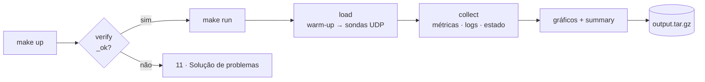

# 10 — Operação e telemetria

## 1. Fluxo de um experimento



1. **`make up`** deixa o lab no ar e verificado.
2. **`make run`** = `load` + `collect`:
   - `load` espera os agentes (até 120 s), aguarda `load.warmup_s` (para o IKE/QKD estabilizar), comanda todos os NODEs
     (`POST /control/start`), espera `load.duration_s + 3 s` e confirma que todos voltaram a *idle*.
   - `collect` reúne tudo e empacota.
3. Repita `make run` quantas vezes quiser: cada execução **acrescenta** eventos ao `metrics.jsonl` de cada NODE (o arquivo
   dentro do contêiner não é truncado). Para isolar uma rodada, destrua e recrie o laboratório ou anote os instantes `phase`.

## 2. Parâmetros de carga (`load:`)

| Chave | Padrão | Efeito |
|---|---|---|
| `warmup_s` | 10 | Espera antes de iniciar. Aumente se o IKE demorar a subir. |
| `duration_s` | 60 | Duração por NODE (os NODEs rodam em paralelo). |
| `probe_interval_ms` | 100 | Intervalo entre sondas, por par. |
| `probe_size_bytes` | 64 | Tamanho nominal da sonda (mínimo 16); o payload UDP real tem `size − 4` bytes. |
| `peers` | `adjacent` | Cada NODE sonda os dois NODEs vizinhos; `none` desliga. |

Cada NODE sonda o **NODE anterior** (saindo por `eth0`/MKTi1) e o **próximo** (por `eth1`/MKTi2). As sondas são marcadas
`protected: true` quando o enlace correspondente tem túnel e `false` nos enlaces de `ipsec.unprotected_links`.

## 3. O que é coletado

| Fonte | Como | Arquivo em `build/<lab>/` |
|---|---|---|
| NODEs | `GET /metrics.jsonl` via `docker exec` | `metrics/NODEi.jsonl` |
| KMEs (log) | `docker cp /var/log/kme.log` | `logs/KMEi.log` |
| KMEs (pools de chaves) | consulta SQLite no contêiner | `logs/KMEi-keys.json` — `{"kme_id":…,"pools":{"kme-sim-2":{"<status>":N,…}}}` |
| CHRs (log IPsec) | REST `/log` filtrado em `ipsec` | `logs/MKTij-ipsec.log` |
| CHRs (estado) | REST: OSPF, `active-peers`, `installed-sa`, `key qkd` | `logs/MKTij-state.json` |
| Consolidação | `plot_metrics` | `plots/summary.json`, `summary_probes.csv`, `*.png` |
| Pacote | tar.gz + manifesto | `output/output.tar.gz` |

`collect` **nunca aborta** por um nó inacessível: o problema vira *warning* (no JSON de saída e em `manifest.json`).
`qnetlab collect --offline` só reprocessa `metrics/` e `logs/` já existentes (sem tocar na rede).

## 4. Métricas e como lê-las

### `plots/summary.json` — `probes`

| Campo | Significado |
|---|---|
| `src`, `dst` | NODE origem e vizinho sondado |
| `protected` | o enlace tem IPsec+PPK? |
| `sent`, `received`, `loss_pct` | sondas enviadas/respondidas e perda (%) |
| `rtt_mean_ms`, `rtt_p50_ms`, `rtt_p95_ms`, `rtt_p99_ms`, `rtt_max_ms` | estatísticas do RTT (só respostas recebidas; percentil por interpolação linear) |

`summary.json` também tem `keys` (pedidos de chave, hoje vazio) e `accuracy` (se a sua aplicação enviou eventos
`accuracy`: `rounds`, `final`, `best`), além de `plots` (lista dos PNGs gerados). Os mesmos dados saem em `summary_probes.csv`
(e `summary_keys.csv` / `summary_accuracy.csv` quando houver linhas).

### Gráficos (`plots/`)

| Arquivo | Conteúdo |
|---|---|
| `rtt_time.png` | RTT de cada sonda ao longo do tempo, protegido (vermelho) × em claro (azul) |
| `rtt_cdf.png` | CDF do RTT, protegido × em claro |
| `loss.png` | Perda (%) por par |
| `key_latency.png` | Latência de obtenção de chave (só se houver `key_request`) |
| `accuracy.png` | Acurácia por rodada (só se houver eventos `accuracy`) |

Os PNGs exigem `matplotlib` (`pip install -e '.[plots]'`); sem ele, só os `summary.*` são gerados.

### Interpretação (guia prático)

| Observação | Provável significado |
|---|---|
| `loss_pct` ≈ 100 % em `protected: true` | Túnel não subiu: com `enforce_encryption`, o claro é descartado. Veja `logs/MKT*-ipsec.log`. |
| Picos periódicos de RTT/perda a cada `proposal_lifetime` | Rekey (nova chave QKD por rekey). Aumente `proposal_lifetime` para comparar. |
| RTT protegido > RTT em claro por poucos ms | Sobrecarga de ESP/CPU do CHR; esperado em virtualização. |
| `logs/KME*-keys.json` com *pools* quase vazios | Consumo > geração: aumente `kme.sync_threshold` ou reduza `generation_delay_s`/`sync_interval_s`. |
| Muitos *warnings* "coleta falhou" | Rede de gerenciamento inacessível ([11](11-troubleshooting.md#no-route-to-host-nos-chrs)). |

## 5. Estrutura do `output.tar.gz`

```text
manifest.json           # lab, data, warnings, sha256 de cada arquivo
metrics/NODE*.jsonl
logs/KME*.log   logs/KME*-keys.json
logs/MKT*-ipsec.log   logs/MKT*-state.json
plots/summary.json  plots/summary_*.csv  plots/*.png
rsc/MKT*.rsc  rsc/MKT*.bootstrap.rsc     # com secret=/ppk-secret=/password= mascarados (***)
```

Verifique a integridade: extraia e compare cada `sha256` do `manifest.json` (`sha256sum`).
Chaves privadas e `state.json` **não** vão no pacote.

## 6. Receitas de experimentos

> Para variar parâmetros crie cópias da topologia (ex.: `topologies/<seu-cenario>.yaml`) e rode `make up TOPO=…`.

**A. Comparar com e sem IPsec (grupo de controle)**

```yaml
ipsec:
  unprotected_links: [2]     # o enlace 2 do anel (MKT22 ↔ MKT31) fica sem túnel
```

O resumo traz `protected: true` e `false` lado a lado; `rtt_cdf.png` os sobrepõe.

**B. Efeito do rekey**

```yaml
ipsec:
  proposal_lifetime: 5m      # ou 30s, 1m (padrão)
```

**C. Taxa de geração de chaves**

```yaml
kme:
  generation_delay_s: 0.05
  sync_interval_s: 1
  sync_threshold: 1000
```

Acompanhe `logs/KME*-keys.json` e o log do KME.

**D. Carga mais intensa**

```yaml
load: { duration_s: 300, probe_interval_ms: 10, probe_size_bytes: 1200 }
```

**E. Vazão com iperf3 (manual)**

```console
$ docker exec -d GNS3.NODE2.<id> iperf3 -s
$ docker exec GNS3.NODE1.<id> iperf3 -c 10.0.3.10 -t 30     # NODE1 → NODE2 através do túnel
```

**F. Sua aplicação (DFL)** — veja [09 §4](09-containers-kme-node.md#colocando-a-sua-aplicação-ex-cliente-dfl).

**G. Anel de 6 sites**

```console
$ make up TOPO=topologies/ring6.yaml && make run TOPO=topologies/ring6.yaml
```

## 7. Boas práticas de reprodutibilidade

- Registre o commit do QNetLab, o YAML usado e `build/<lab>/output/output.tar.gz` (o `manifest.json` guarda data e *warnings*).
- Fixe `router.update_version` (ex.: `7.22.1`) para que todos os CHRs rodem exatamente a mesma versão.
- Não reutilize `build/` entre versões incompatíveis do framework; `make clean` + `make up` recria tudo.
- Use `-v` ao coletar evidências de uma falha.
- Aguarde `verify` com `_ok: true` **antes** de `run`; sem túnel de pé, as medidas de "protegido" não têm significado.

## 8. Experimentos controlados: falhas, captura e custo

Para estudar o comportamento da rede sob falhas e medir o custo da emulação, use `fault`, `capture` e `bench`
([06 §2.1](06-cli-reference.md#21-experimentos-fault-capture-bench)). Roteiro típico (falha do KME, REDE-02 do
[plano de validação](14-validation-test-plan.md)):

```console
$ make up && qnetlab bench sample --duration 30 --label baseline -t topologies/ring4.yaml   # estado estável
$ qnetlab capture run MKT12 MKT21 --duration 180 --label kme-fail -t topologies/ring4.yaml &   # opcional
$ sleep 20; qnetlab fault node KME1 stop  -t topologies/ring4.yaml                         # T0: KME1 cai
$ sleep 120; qnetlab fault node KME1 start -t topologies/ring4.yaml                        # T1: volta
$ wait                                                                                     # termina a captura
$ make run                                                                                 # coleta tudo
```

- Os instantes T0/T1 ficam em `logs/fault-events.jsonl` **e** no `metrics.jsonl` dos NODEs (evento `type: "fault"`), na mesma
  linha do tempo das sondas: dá para ler perda e RTT antes, durante e depois da falha.
- Filtros de enlace (`fault link`) valem para os dois sentidos da passagem pelo enlace: um atraso de 30 ms em um enlace
  aparece como ~60 ms no RTT de um caminho que o atravessa. O GNS3 aplica atraso/perda/corrupção por pacote no *ubridge*;
  não modela largura de banda nem fila.
- `bench` mede **o host onde o `qnetlab` roda** (`/proc` e `docker stats`): só vale com o servidor GNS3 local. Uma medição
  com CPU do host acima de 80 % (p95) é marcada `saturation.valid: false` e **não deve ser usada** para concluir sobre
  desempenho. Cada relatório registra o ambiente (CPU, RAM, kernel, versões, hash do YAML).
- `bench up` / `qnetlab up` gravam `bench/up-<UTC>.json` com os segundos de `pki`, `images`, `deploy`, `bootstrap`,
  `upgrade`, `configure` e `verify`.
- `tests/lab` automatiza esses experimentos e grava a evidência em `build/<lab>/evidence/` ([tests/lab/README.md](../tests/lab/README.md)).
