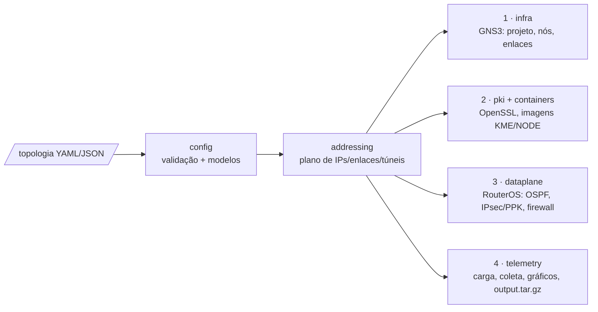

# QNetLab — Documentação técnica

QNetLab é um framework de *Infrastructure as Code* (Python orientado a objetos, topologias declarativas em YAML/JSON)
que cria, configura, mede e destrói laboratórios de **distribuição quântica de chaves (QKD)** no **GNS3**. Os
laboratórios reproduzem os cenários MITACS do grupo: anéis de 4 ou 6 sites com roteadores **MikroTik CHR (RouterOS 7)**,
túneis **IPsec IKEv2 com PPK (RFC 8784)** alimentados por chaves QKD, **OSPFv2**, PKI própria e telemetria
reprodutível.

> **Versão documentada:** QNetLab 0.1.0 · RouterOS ≥ 7.22 · GNS3 2.2.x · Python ≥ 3.10.
> Estado de validação: o código é coberto por mais de 100 testes automatizados (sem GNS3); a execução ponta a ponta com GNS3, Docker e
> CHRs reais é feita pelo usuário (veja [13 — Limitações](13-limitations-roadmap.md)).

## Como usar esta documentação

| Se você quer… | Leia |
|---|---|
| Entender o que o QNetLab é, o que não é, e o vocabulário | [01 — Visão geral e glossário](01-overview.md) |
| Subir o laboratório pela primeira vez | [04 — Instalação e guia rápido](04-installation-quickstart.md) |
| Entender como as peças se encaixam | [02 — Arquitetura](02-architecture.md) e [Decisões de projeto](decisions.md) |
| Saber qual IP/interface/túnel é qual | [03 — Topologia e endereçamento](03-topology-addressing.md) |
| Alterar parâmetros de um experimento | [05 — Referência de configuração](05-configuration-reference.md) |
| Consultar um comando ou alvo do Makefile | [06 — Referência da CLI](06-cli-reference.md) |
| Avaliar riscos, PKI e tratamento de segredos | [07 — Segurança](07-security.md) |
| Entender (ou depurar) a configuração gerada nos roteadores | [08 — Configuração RouterOS](08-routeros-config.md) |
| Entender os contêineres KME/NODE e escrever a sua aplicação | [09 — Contêineres: KME e NODE](09-containers-kme-node.md) |
| Rodar experimentos e obter métricas | [10 — Operação e telemetria](10-operations-telemetry.md) |
| Resolver um erro | [11 — Solução de problemas](11-troubleshooting.md) |
| Contribuir, testar, estender | [12 — Guia de desenvolvimento](12-development.md) |
| Saber o que ainda falta | [13 — Limitações e roteiro](13-limitations-roadmap.md) |
| Planejar a validação do framework (fidelidade, segurança, rede, desempenho, utilidade) | [14 — Plano de validação](14-validation-test-plan.md) |

## Mapa rápido (as 4 camadas)



## Convenções desta documentação

- **Idioma:** português do Brasil; identificadores, comandos e chaves de configuração ficam como no código.
- **Blocos de código** com `$` são comandos de shell no *host* (a máquina que roda o QNetLab e o GNS3). Blocos `routeros`
  são comandos do console do CHR.
- **Nomes:** `MKTij` = roteador *j* (1|2) do site *i*; `KMEi`, `NODEi`, `NATn` seguem os laboratórios MITACS.
- **Avisos:** *Nota* = informação útil; *Atenção* = pode causar perda de dados, falha silenciosa ou exposição de segredo.
- Trechos de configuração e saídas foram obtidos executando o próprio QNetLab (`qnetlab plan`, `qnetlab render`) sobre
  `topologies/ring4.yaml`.
- [05 — Referência de configuração](05-configuration-reference.md) é **gerado** por `scripts/gen_config_reference.py` e
  verificado por um teste: não edite à mão.

## Estrutura do repositório

```text
qnetlab/
├── docs/                    # esta documentação
├── docker/node/             # imagem-base de KME/NODE (Dockerfile, entrypoint, KME vendorizado, agente SAE)
├── schema/                  # JSON Schema da topologia
├── scripts/                 # utilitários (plot_metrics.py, gen_config_reference.py)
├── src/qnetlab/             # código (config, addressing, infra, pki, containers, dataplane, telemetry, faults, capture, bench, cli, lab)
├── templates/               # Jinja2: mikrotik/*.rsc.j2 e docker/*.j2
├── tests/                   # pytest (sem GNS3/Docker); tests/lab = laboratório real, opt-in
├── topologies/              # ring4.yaml, ring6.yaml
├── Makefile · pyproject.toml · requirements.txt
└── build/<topologia>/       # (gerado) artefatos, estado e segredos — fora do controle de versão
```
